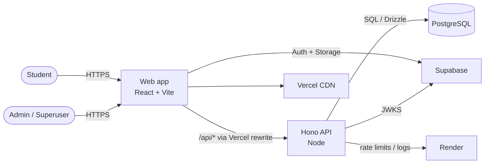
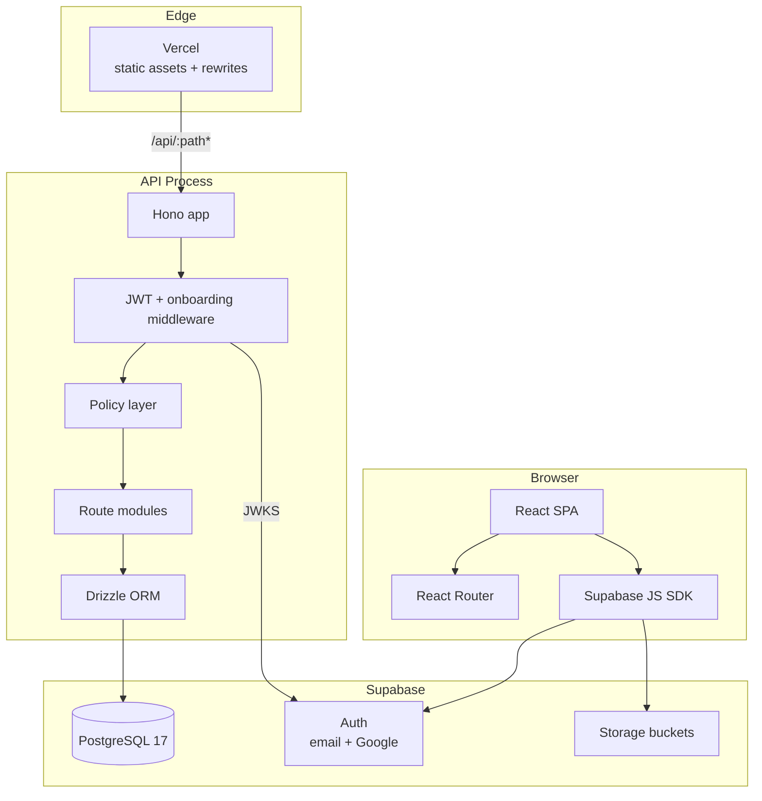
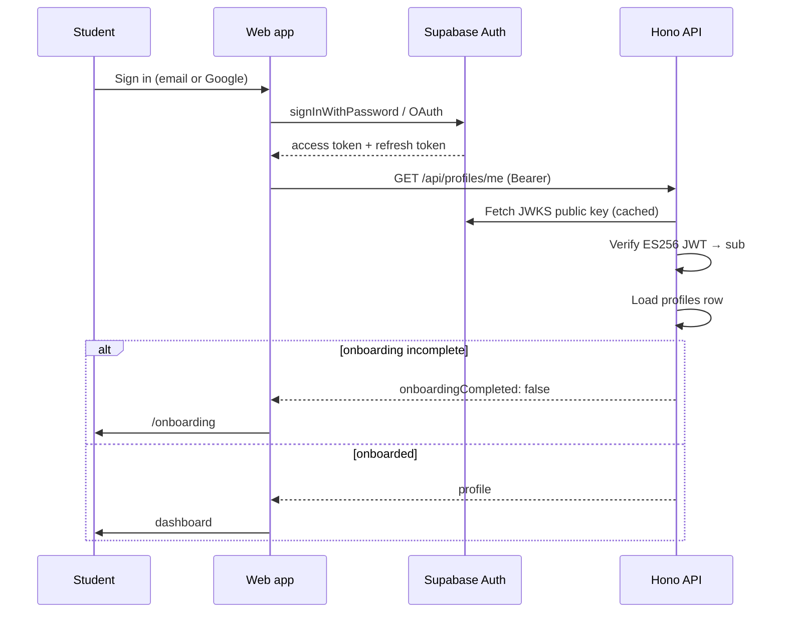
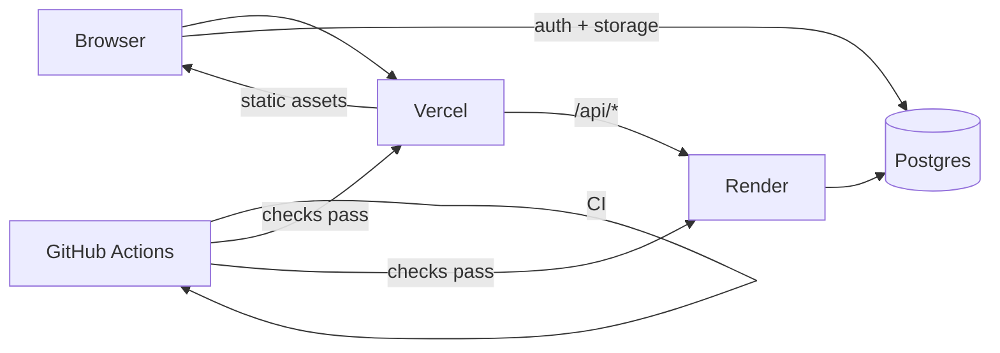

# System Architecture

**UniMARKY** — React SPA + Hono API + Supabase.

---

## 1. Overview

UniMARKY is a multi-tenant (per-university) campus platform. The browser runs a React single-page app. It talks to a Hono API for all campus data, and to Supabase directly for authentication and image storage. The API owns the PostgreSQL schema through Drizzle ORM and enforces authentication, roles, university scoping and rate limits.

### Design principles

1. **Campus is the tenant.** Every listing, community and resource is scoped by `university_name`.
2. **The API is the only data path.** The browser never queries campus tables directly; it uses the API with a Supabase JWT.
3. **One account, one identity.** Supabase Auth issues the session; the API verifies the JWT via JWKS and maps the `sub` to `profiles.id`.
4. **Editorial UI, not a dashboard template.** A shared design system (`design.md`) keeps public and protected pages consistent.
5. **Small, boring infrastructure.** Two stateless deployments (web/API) and one managed Postgres.

## 2. System context



## 3. Container view



## 4. Frontend architecture

```text
apps/web/src/
├── components/
│   ├── layout/      MainLayout, Sidebar, ProtectedRoute, PageLoader
│   ├── seo/         RouteMeta (per-route titles/canonical/robots)
│   ├── legal/       CookieConsent
│   ├── auth/        AuthForm
│   ├── ui/          shadcn/Radix primitives
│   └── site/        shared public navigation/footer data
├── features/
│   ├── landing/     Landing page + public shell
│   ├── public/      About, Contact, Terms, Privacy
│   ├── auth/        Sign in, forgot/reset password
│   ├── onboarding/  University + mobile setup
│   ├── dashboard/   Student home
│   ├── marketplace/ Listing, item, my-listings, create/edit
│   ├── campus/      Lost & Found listing
│   ├── lostfound/   Item, report, my-listings, edit
│   ├── lifestyle/   Food + Housing (list/detail)
│   ├── study/       Study resources
│   ├── communities/ Discover, detail, create, manage
│   ├── profile/     Profile + danger zone
│   ├── roles/       Request superuser
│   ├── superuser/   Food/housing/study management
│   └── admin/       Role approval + moderation
├── hooks/           useAuth and shared hooks
├── lib/             API client, Supabase, uploads, compression
└── App.tsx          Routes, route metadata, cookie notice
```

**Routing:** public routes (`/`, `/auth`, `/forgot-password`, `/reset-password`, `/about`, `/contact`, `/terms`, `/privacy`) and two protected gates:

- `ProtectedRoute requireOnboarding={false}` → `/onboarding`
- `ProtectedRoute requireOnboarding={true}` → app shell + workspace routes

**Data fetching:** a small `api` client attaches the Supabase access token to every request, normalizes errors and exposes `get/post/patch/delete`. Pages own their loading/empty/error states.

**Design system:** landing/public pages use the editorial stylesheet; workspace pages use `.um-editorial` primitives; the protected shell reuses the landing sidebar/frame so navigation is identical across the product.

## 5. Backend architecture

```text
apps/api/server/
├── index.ts             app, CORS, security headers, body limit, rate limits, routes
├── env.ts               env validation + CORS allow-list
├── middleware/
│   ├── auth.ts          JWT (JWKS) + profile + onboarding gate
│   ├── policies.ts      isAdmin / canModify / hasPermission
│   ├── permission.ts    requireAdmin / requirePermission
│   ├── rateLimit.ts     in-memory sliding window
│   └── requestLog.ts    structured JSON logs + request id
├── routes/              profiles, marketplace, lostfound, food,
│                        accommodation, study, communities, dashboard,
│                        roleRequests, social, account
├── db/
│   ├── schema.ts        Drizzle schema (18 tables)
│   ├── index.ts         pooled Postgres connection
│   └── seed.ts          sample data
└── utils/               JWKS, onboarding, account successor
```

### Request pipeline

```text
request
  → requestLog            (id, timing)
  → CORS                  (allow-listed origins)
  → secureHeaders         (CSP-adjacent API headers, HSTS, nosniff)
  → bodyLimit (1 MB)
  → rateLimit (180/min; stricter on onboarding/account)
  → authMiddleware        (Bearer JWT → userId → profile)
  → onboarding gate       (only /profiles/me and /profiles/onboarding allowed early)
  → route handler         (policy checks + Drizzle)
  → response
```

### Authorization model

| Role | Source | Scope |
|---|---|---|
| `normal` | `profiles.role` | Own content; all student features |
| `superuser` | role request approval | Food, accommodation and study content |
| `userX` (admin) | assigned | Campus-wide moderation, role approval |
| `moderator` | `community_members.role` | One community: posts, members, settings |

`user_permissions` grants scoped capabilities (`community.create`, `food.manage`, `housing.manage`, `community.manage`, etc.) globally, per university or per department. Admins bypass the table.

## 6. Authentication flow



- Tokens are stored by the Supabase SDK in local storage; the API only trusts the signed JWT.
- `ProtectedRoute` re-checks `/profiles/me` whenever the gate mode changes, preventing the post-onboarding redirect loop.
- Password reset uses Supabase's email link; the reset page updates the password in the recovery session.

## 7. Tenancy and data access

- The JWT gives identity; the profile gives `university_name`.
- Feed queries add `where university_name = <profile.university_name>`.
- Mutations verify ownership or moderator/admin rights before writing.
- Public profile fields exclude mobile number and ID card URL.
- Account deletion is a transaction: content cleanup, community handover, profile removal and `auth.users` deletion.

## 8. Deployment topology



| Component | Platform | Notes |
|---|---|---|
| Web | Vercel | SPA build, SPA rewrites, security headers, static SEO pages |
| API | Render | Node service, env-based DB/JWT config, health check |
| Data | Supabase | PostgreSQL, Auth, Storage |
| CI | GitHub Actions | typecheck, tests, web build; post-deploy smoke test |

See [deployment.md](deployment.md) for configuration.

## 9. Key decisions

| Decision | Why |
|---|---|
| Separate SPA + API (not Next.js) | Clear API boundary; simple static hosting; API reusable by future clients |
| Supabase Auth | Email/Google out of the box, JWT signing, storage, managed Postgres |
| Verify JWTs via JWKS | No shared secret; keys rotate at Supabase |
| Drizzle + typed schema | Type safety and reviewable migrations |
| `university_name` tenant key | Simple campus scoping without a separate tenant service |
| In-memory rate limiting | Zero extra infrastructure; adequate for one instance |
| Static SEO pages for public routes | Crawlers get full HTML without a headless prerender |

## 10. Reliability, observability and risks

- **Health:** `GET /healthz` for uptime checks.
- **Logs:** one JSON line per request with request id, status, duration, user id and IP; no auth headers or bodies.
- **CI:** typecheck, tests and web build; deploy verification checks `/healthz` and that protected routes return 401.
- **Known limits:** rate limiting is per instance; no distributed cache; no queue; full body prerender for public pages is not implemented; no native apps.
- **Failure modes:** Supabase outage → API 5xx; Render cold start → first request latency; Vercel rewrite misconfiguration → `/api` 404s (keep the rewrite list in sync).

## 11. Future architecture options

1. **Realtime feed** via Supabase Realtime; queue only for notification fan-out (see the community design discussion).
2. **Distributed rate limiting** (Cloudflare/Upstash) when the API scales beyond one instance.
3. **Prerender/SSG** for the public pages and campus hubs.
4. **Search** (Postgres trigram or a managed index) for marketplace/study.
5. **Object storage lifecycle** and image resizing for user uploads.
