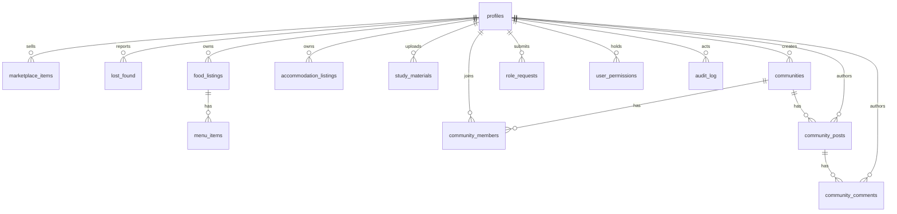

# Database Schema

**Engine:** PostgreSQL 17 (Supabase) · **ORM:** Drizzle · **Schema:** `apps/api/server/db/schema.ts`

---

## 1. Conventions

- Primary keys are UUIDs (`gen_random_uuid()`).
- Timestamps are `timestamptz` with `now()` defaults.
- `university_name` is the tenant key on every campus-scoped table.
- Money is `numeric`; ratings/review counts are `numeric`/`integer`.
- Foreign keys to `profiles.id` use `ON DELETE CASCADE` for personal content and `SET NULL` for references that must survive (e.g. audit actor).
- Row Level Security (RLS) is enabled on all public tables.

## 2. Table catalog

| # | Table | Purpose |
|---|---|---|
| 1 | `profiles` | One row per auth user: name, university, role, onboarding |
| 2 | `marketplace_items` | Campus buy/sell listings |
| 3 | `lost_found` | Lost/found reports |
| 4 | `food_listings` | Restaurants/cafes on and around campus |
| 5 | `menu_items` | Dishes for a food listing |
| 6 | `accommodation_listings` | PGs, hostels and apartments |
| 7 | `study_materials` | Notes, papers and resources |
| 8 | `communities` | Campus communities |
| 9 | `community_members` | Membership + role (`member` / `moderator`) |
| 10 | `community_posts` | Community feed posts |
| 11 | `community_comments` | Comments on community posts |
| 12 | `role_requests` | Superuser requests + review state |
| 13 | `user_permissions` | Scoped capability grants |
| 14 | `audit_log` | Append-only privileged action trail |
| 15 | `social_posts` | Legacy campus feed (archived) |
| 16 | `comments` | Legacy social comments (archived) |
| 17 | `post_likes` | Legacy feed likes (archived) |
| 18 | `announcements` | Legacy announcements (retired) |

## 3. Relationship diagram



## 4. Core tables

### 4.1 `profiles`

| Column | Type | Notes |
|---|---|---|
| `id` | uuid PK | Same UUID as `auth.users.id` |
| `full_name` | text | Display name |
| `university_name` | text | Tenant key |
| `department` | text | Academic department |
| `class` | text | Year/class label |
| `id_card_url` | text | Private; never exposed publicly |
| `is_verified` | boolean | Manual verification flag |
| `onboarding_completed` | boolean | Set by `/profiles/onboarding` |
| `mobile_number` | text | Private; 10 digits |
| `role` | text | `normal` / `superuser` / `userX` |
| `created_at`, `updated_at` | timestamptz | |

### 4.2 `marketplace_items`

| Column | Type | Notes |
|---|---|---|
| `id` | uuid PK | |
| `seller_id` | uuid FK → profiles | Cascade delete |
| `title` | text | |
| `description` | text | |
| `price` | numeric | INR |
| `category` | text | textbooks, electronics, dorm-decor, fashion, services, fitness |
| `condition` | text | new, like-new, great, good, fair |
| `manufactured_year` | text | Optional |
| `is_negotiable` | boolean | |
| `image_url` | text | Public storage URL |
| `university_name` | text | Tenant |
| `created_at`, `updated_at` | timestamptz | Feed ordering |

Indexes: `(university_name, created_at)`, `(seller_id)`.

### 4.3 `lost_found`

| Column | Type | Notes |
|---|---|---|
| `id` | uuid PK | |
| `reporter_id` | uuid FK → profiles | Cascade |
| `item_name` | text | |
| `type` | text | `lost` / `found` |
| `location` | text | |
| `status` | text | `open` / `resolved` |
| `description` | text | |
| `image_url` | text | |
| `university_name` | text | Tenant |
| `created_at`, `updated_at` | timestamptz | |

### 4.4 `food_listings` and `menu_items`

`food_listings`: `id`, `name`, `cuisine`, `rating`, `location`, `image_url`, `university_name`, `description`, `tags`, `address`, `phone`, `timing`, `price_range`, `review_count`, `owner_id` (FK → profiles, set null).

`menu_items`: `id`, `restaurant_id` (FK → food_listings, cascade), `name`, `description`, `price`, `category`, `image_url`, `is_veg`, `is_available`, `rating`, `review_count`, `created_at`.

### 4.5 `accommodation_listings`

`id`, `name`, `type` (`PG` / `Hostel` / `Apartment`), `rent_range`, `location`, `contact`, `university_name`, `description`, `address`, `phone`, `amenities`, `images` (JSON string array), `min_price`, `max_price`, `rating`, `review_count`, `owner_id`, `created_at`.

### 4.6 `study_materials`

`id`, `department`, `year`, `subject_name`, `category`, `title`, `description`, `file_url`, `uploaded_by` (FK → profiles, set null), `university_name`, `created_at`.

### 4.7 Communities

**`communities`**: `id`, `name`, `description`, `category`, `university_name`, `created_by` (FK → profiles, set null), `member_count`, `post_count`, `is_archived`, `created_at`, `updated_at`.

**`community_members`**: `id`, `community_id` (FK, cascade), `user_id` (FK, cascade), `role` (`member`/`moderator`), `joined_at`. Unique per community/user.

**`community_posts`**: `id`, `community_id` (FK, cascade), `author_id` (FK, set null), `content`, `image_url`, `created_at`, `updated_at`.

**`community_comments`**: `id`, `post_id` (FK, cascade), `author_id` (FK, set null), `content`, `created_at`.

### 4.8 Roles and permissions

**`role_requests`**: `id`, `user_id` (FK, cascade), `requested_role`, `reason`, `status` (`pending`/`approved`/`rejected`), `reviewed_by` (FK, no action), `created_at`/`reviewed_at`.

**`user_permissions`**: `id`, `user_id` (FK, cascade), `permission`, `scope_type` (`global`/`university`/`department`), `scope_value`, `granted_by` (FK, set null), `expires_at`, `created_at`. Unique on `(user_id, permission, scope_type, scope_value)`.

**`audit_log`**: `id`, `actor_id` (FK, set null), `action`, `entity_type`, `entity_id`, `metadata` (jsonb), `university_name`, `created_at`. Append-only.

## 5. Legacy tables

`social_posts`, `comments`, `post_likes` and `announcements` belong to the retired Unimedia feed. Writes return `410 Gone`; reads are archive-only. They are kept for data continuity but are not part of the current product surface.

## 6. Row Level Security

RLS is enabled on every public table. Direct browser access uses the anon key only for Auth/Storage, so the API (project database role) is the normal data path. RLS protects against accidental direct table access and Supabase client misuse.

Recommended policies (already applied in migrations):

- `profiles`: select public fields; update only your own row through the API.
- Listings: select by university; insert/update/delete only as owner (or admin).
- Communities/posts/comments: select by community membership/university; write as member; moderation as moderator/admin.
- `role_requests`/`user_permissions`/`audit_log`: admin-only.

## 7. Migrations and commands

Migrations live in `apps/api/drizzle/` (`0000`–`0008`), with `meta/_journal.json`.

```bash
# Generate a migration after editing schema.ts
npm run db:generate

# Apply migrations (DATABASE_URL should use the direct 5432 connection)
npm run db:migrate

# Optional seed
npm run db:seed --workspace api
```

Never edit an applied migration; add a new one. Review generated SQL before applying.

## 8. Seed data

`apps/api/server/db/seed.ts` provides sample data. The current Supabase project also contains seeded content for Central University of Haryana (marketplace, lost & found, food, menu items, accommodation). Seeding is university-scoped; a user sees only their campus.

## 9. Data lifecycle

- Account deletion removes personal listings, reports, posts, comments and memberships, transfers or removes owned communities, clears reviewer references, deletes the profile and finally `auth.users` (cascading sessions/identities).
- Uploaded images are public URLs; deleting a row does not automatically delete the storage object. Add a lifecycle job if storage cost matters.
- `audit_log` is retained for accountability; actor references become `NULL` when a profile is deleted.
